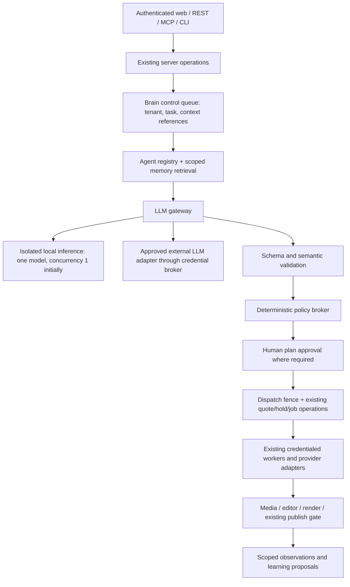

# Nightshift AI Brain — architecture specification v1.0

Status: **P0 specification, proposed; no runtime change or release approval**.
Prepared: 2026-11-15 (owner timezone: Asia/Tashkent).
Source baseline: `f985b3afd371c0677357670da436ef2074fdb036` (`main` fetched read-only).
Documentation branch: `codex/ai-brain-p0-docs`.

The owner authorized documentation only. Application code, SQL/migrations, secrets,
server configuration and production are outside this change. P1 requires a separate
owner decision after review of this specification. Writing these documents does not
remediate any deployed vulnerability or prove a model's speed.

## 1. Decision and evidence boundary

Add a policy-controlled planning and intelligence layer to the existing Creative OS.
Keep its media adapters, prices, ledgers, job queues, editor and publishing gates.
One resident local LLM serves isolated agent contexts through a bounded queue; agents
are permissioned roles, not separately loaded models or autonomous operating-system users.

The earlier audit used `e02c884a`. The repository's remote main is substantially newer.
This specification uses `f985b3af`; the original checkout remains untouched. In particular,
Film Studio data, drafts, money functions and the voice-explainer engine now exist.
Do not recreate them based on the older audit. Live migration/flag values, actual server
resources and real provider availability remain **unverified**. PR descriptions are
evidence of proposed work and author-reported checks, not our executed tests.

| Status word | Meaning |
| --- | --- |
| Implemented | Source exists at the baseline; not a live-service claim |
| Gated | Source exists but requires a flag, permission, terms clearance, price or worker |
| Open PR | Proposed changes outside the baseline; never treated as installed |
| Proposed | Contract in this P0 package, not implemented |
| Unverified | Evidence has not been collected; never shown as zero or success |

## 2. Existing components are authoritative

| Concern | Reuse | Delta, if needed |
| --- | --- | --- |
| Pipeline | [main.py](../main.py), [pipeline stages](../modules/pipeline_stages.py), checkpoints | A Brain task proposes or requests an existing operation; it does not replace the pipeline |
| Creative jobs | [creative worker](../modules/creative_worker.py), [model registry](../modules/model_registry.py), capability adapters | Add approved LLM contracts and dispatch checks; no second generation queue/ledger for the same job |
| Site credits | [0020](../supabase/migrations/0020_credits.sql), [0036](../supabase/migrations/0036_creative_jobs.sql) | Reuse quote/hold/capture/release and idempotency |
| Public API money | [API](API.md), existing API balance and scopes | Preserve the API payer; never spend site and API balances for one operation |
| Studio Planner design | [PLANNER.md](studio/PLANNER.md), merged design #791, explicitly not built | Use its template/catalog/gate/executor design as the execution foundation; this package adds cross-agent security, inference and memory contracts |
| Film projects | [Film Studio](FILM_STUDIO.md), 0166/0171, film versions, scenes, takes, segments and quotes | Brain references film/version/quote; it does not create parallel film/scenes tables |
| Storyboard approval | [storyboard review](../modules/storyboard_review.py), 0057/0058 | Preserve workflow and add manifest-bound authorization at the integration boundary |
| Editor and assembly | [timeline](../modules/timeline.py), [film cut builder](../modules/film_timeline.py), [render fields](editor-render-fields.md) | Structured edit proposals validated by existing validators |
| Media | Existing media assets, rights, provenance, storage and serving | Refer to immutable asset versions; no path or arbitrary URL supplied by a model |
| Channel intelligence | Existing poller, analytics, comments and learning modules | Scoped read tools and supported-metric contracts |
| Brand and character | Style kits, characters and Channel DNA | Resolve approved versions into the plan |
| Publishing | [publish gate](../modules/publish_gate.py), [exact-cut approval](APPROVE_PUBLISH_1B.md) | No new publish path or more autonomous default |
| Web/API/MCP/CLI | [MCP](MCP.md), [API](API.md), existing operations layer | One policy boundary across transports |

[ARCHITECTURE.md](ARCHITECTURE.md) remains the general system map. This document owns
the Brain delta. Old roadmap checkboxes do not override current source. The separate
[unfinished-work audit](CLAUDE_UNFINISHED_WORK_AUDIT.md) records relevant open PRs.

### Alignment with the existing Studio Planner design

There must be **one** planner gate/executor, not a Studio planner and a competing Brain
executor. In [PLANNER.md](studio/PLANNER.md), v1 uses fixed templates with AI-filled slots,
a server-generated eligible-tool catalog, deterministic validation/quote/approval and
server execution. Retain that restricted scope; the 21 roles do not authorize free-form
model-generated DAGs. Its proposed `studio_plans` and approval records are the first
mapping candidates for the logical Brain control records below, not additional parallel tables.

Preserve its plan-level hold, child-job payer binding and explicit partial-result charge
acknowledgement. Film-owned work keeps `payer='film'` and film segment settlement; plan-owned
work must not also reserve per-child retail holds. Plain existing creative/workflow jobs
keep their current payer until a separately reviewed adapter maps them through the gate.
No new caller may use a payer label to evade a valid parent hold.

The Planner design's API approval scope is not a human identity by itself. Initial Brain
v1 enables interactive owner/admin approval only; API/MCP may draft and quote, but cannot
mint Brain approval until a separately reviewed delegation design establishes the exact
human grant, effect set, digest and revocation checks. Existing unrelated MCP operations
are not changed by this documentation. Likewise, its provider-health TTL proposal is reused,
not implemented here; a probe is not a current health guarantee. Unknown/degraded health
must be shown at approval and cannot waive an unavailable model or missing price.

The documents' phase labels are local: **Brain P1** is not **Film Studio P1** or
**Studio Planner P1**. The roadmap names each work package explicitly.

## 3. Runtime and trust boundaries

The model produces data. It cannot execute a shell, SQL, a URL fetch or a tool by
writing a command. The Brain planner and inference container have no provider keys,
Supabase service role, production repository mount, SSH, root, Docker socket or deploy
identity. Only the broker crosses the action boundary, using narrow authenticated
operations. Provider credentials remain in existing server-side credential resolution.
The broker is deterministic code, not another LLM allowed to waive policy.

The external LLM route is not arbitrary internet access: an adapter-specific allowlist,
data classification and explicit provider policy control what may leave the host.
No external model may be silently used when the approved local model is unavailable.

## 4. Provider-agnostic LLM contract (proposed)

The current [provider protocols](../modules/providers.py) are not proof of a wired text
LLM abstraction. Preserve existing Gemini behavior with an adapter before moving callers.
Do not make every caller depend on an OpenAI-compatible HTTP dialect.

| Contract | Required fields/behavior |
| --- | --- |
| Request | Task/trace ID, server-bound tenant context reference, exact provider/model revision, typed messages, schema ID/version, output/thinking token bounds, timeout, approved tool-schema list, data classification |
| Result | Validated object or closed error; actual model/runtime revision; measured usage or `unknown`; timings; finish reason; provider request ID kept private |
| Capability descriptor | Context/output limits, supported schema subset, tool format, vision/audio support, languages assessed, license revision, availability/probe freshness |
| Closed errors | `model_unavailable`, `schema_invalid`, `context_limit`, `timeout`, `quota`, `auth`, `policy_denied`, `budget_denied`, `killed`, `outcome_unknown` |
| Retry | Bounded by task deadline and reserved budget; same approved model/input; no blind resubmit after ambiguous acceptance |

Tool-call arguments are validated against both their schema and authorization policy.
Unsupported schema keywords fail before inference. Invalid output cannot enter a paid
tool; any repair attempt is separately bounded and metered. Streaming text is a draft,
never executable tool authority. Do not persist chain-of-thought; retain bounded decision
summaries, evidence references and policy reason codes instead.

## 5. Task state and scheduling (proposed)

Logical control records are `BrainTask`, `TaskAttempt`, `ToolIntent`, `PlanManifest`,
`PlanApproval`, `DispatchPermit`, and `PolicyEvent`. These are conceptual contracts,
not instructions to create seven new tables: implementation must map existing jobs,
events, quotes and projects first and add only missing control state.

`queued → running → proposal_ready → awaiting_approval → authorized → executing →
succeeded | failed | cancelled | outcome_unknown`. A read-only task can finish at
`proposal_ready`; there is no reason to grant it execution permission. Approval may
expire or be invalidated before execution. A kill blocks new dispatch, not accounting
reconciliation for requests already sent.

Use leases and fencing tokens so a stale attempt cannot finish a newer task or spend
again. A task owns a bounded context, not a global conversation shared across tenants.
Schedule interactive drafts ahead of periodic reports with per-org fairness; neither may
starve reconciliation. Start local inference at concurrency 1. Do not put inference inside
the pipeline worker's render loop. Queue admission has per-org limits and deadlines.

## 6. Versioned Idea-to-Video manifest

Prefer existing Film Studio drafts where their domain fits, and existing pipeline
storyboard revisions for pipeline videos. A manifest is an immutable authorization
view over these records, not another project document users must maintain.

| Manifest section | Content included in the execution digest |
| --- | --- |
| Identity | Schema/canonicalization version, tenant, project/channel, task, plan revision, domain record/version |
| Creative plan | Sourced research and caveats, script, character/brand versions, storyboard, scene descriptions, image/video prompts, camera motion, voice description, music/SFX, timeline, thumbnail, title/description/SEO |
| Inputs | Asset IDs, immutable content hashes/versions, rights and consent references, resolved memory versions |
| Models | Exact model/provider revisions, adapters and runtime/template revisions that affect output, capability/terms/probe references |
| Money | Existing payer type, quote IDs, retail price/version, currency/unit, maximum credits, retry allowance, expiry; internal cost budget remains private |
| Effects | Explicit allowed actions and destinations; generation/export approval never implies publish/reply approval |
| Policy | Applicable policy/schema versions and authorization expiry |

Use SHA-256 over a defined canonical semantic representation. Specify UTF-8 encoding,
sorted object keys, ordered arrays, deterministic integer/decimal units, no NaN/Infinity
or duplicate keys, and a versioned test corpus across runtimes. Do not hash raw client
JSON. Exclude only allowlisted display-only labels such as translated button copy;
any field influencing generation, money, rights, destination or authorization is semantic.

Proposed canonicalization v1 uses RFC 8785/JCS with a restricted schema: integer JSON
numbers within the interoperable safe-integer range, integer milliseconds and hundredths
of retail credits, and fixed-point decimal strings for quantities requiring more precision
(no exponent or insignificant trailing zeros). Strings preserve exact Unicode code points
with no normalization; reject unpaired surrogates and duplicate object keys before hashing.
Canonical bytes use UTF-8, no BOM and no added newline. Object-key ordering follows JCS,
not locale collation. SQL/TypeScript/Python must match golden byte/digest fixtures; until
they do, use one authoritative canonicalizer and fail closed on disagreement. Existing film
MD5 quote generation remains unchanged and is not claimed to implement this format.

An existing film quote (`fq-<version>-<md5>`, 30-minute quote validity in 0171) remains
required. It is not a replacement for the proposed SHA-256 Brain approval, nor is that
approval a replacement for the quote or exact-cut publishing approval. Keep their
separate meanings and use the earliest applicable expiry.

Approval is recorded by an authorized human session, bound to the digest, actor,
tenant, effect set, version, maximum charge and expiry. The LLM cannot approve, renew,
expand or sign it. Any semantic change requires a new immutable revision, quote and
human approval. Replays return the existing operation only when the full binding matches.
Membership revocation, asset deletion/consent withdrawal, model unavailability, policy
change or a kill is checked again at dispatch and can invalidate an unchanged manifest.

## 7. Execution order and failure semantics

1. Authenticate outside the model and derive tenant/role/channel from server state.
2. Resolve immutable input and memory versions; build the proposal with no external effect.
3. Validate schema, semantics, rights, exact model availability and freshness.
4. Compute the quote with existing operations; show the complete plan and retail price.
5. Record exact human approval; do not accept a client-supplied `approved=true`.
6. Under a consistent lock/fence order revalidate approval, current kill generation,
   permissions, model policy, platform cost cap and payer balance; reserve through the
   existing ledger and bind one job/idempotency key.
7. At the actual worker/provider boundary consume the bounded dispatch permit and
   recheck the fence. Record `submitting` before sending; persist provider task identity.
8. Poll/reconcile known work; settle existing holds exactly once and record actual costs
   privately. Preserve existing customer hold-release policy on failed/uncertain creative
   jobs while keeping unresolved platform exposure counted separately; do not lock customer
   credits indefinitely. Never invent external cancellation/vendor-refund success.

A transaction cannot atomically include a remote HTTP call. The dispatcher therefore
linearizes a short-lived send permit against the kill fence. Work already permitted or
sent can finish or incur cost; a kill stops subsequent permits and retries. Cancellation
is attempted only where supported. This residual is disclosed in the security policy.

Preserve Studio Planner's recorded technical-retry policy: known-outcome technical
failures may use the same approved model/inputs within the original retry allowance,
deadline and platform-cost cap, without increasing the customer charge. Each purchase
needs a new bounded permit; polling/reconciliation of the same task does not. A user
re-roll or exhausted/changed plan needs a new quote and approval. An unknown outcome
never authorizes an automatic second purchase.

## 8. Resource and economic decision

The owner specifies i7-6700 (4 physical cores/8 threads), 64 GB RAM, no dedicated GPU,
Ubuntu 24.04, 2×512 GB NVMe and 2×4 TB HDD. RAID, usable RAM, workload peaks and actual
server identity are unverified. AX42 sizing in old deploy guides is not this CPU's capacity.

The current pipeline worker has a 48 GiB memory limit. Additional service limits and a
resident LLM cannot be treated as simultaneously safe on a nominal 64 GB machine. Limits
are not usage measurements or reservations; CPU shares are not hard quotas.

Initial operating proposal: one CPU-heavy lane at a time (inference or render/audio),
with latency acceptance measured before allowing overlap. A model is eligible only if
its weights + KV cache + scratch + other measured peaks + OS/cache headroom fit actual
available memory. No production diffusion/video generation is promised on this CPU.
See [benchmark/resource/cost specification](AI_MODEL_BENCHMARK.md).

Default P0 paid-call budget is **$0**; no benchmark was executed. A larger model is not
selected because weights fit. Cost per successful accepted task, quality, queue latency
and commercial rights determine routing. Existing paid APIs remain available only through
explicitly approved plans and prices. No guaranteed savings or live payment readiness is claimed.

## 9. P0 package and P1 entry gate

| Specification | Authority |
| --- | --- |
| [AI_AGENT_REGISTRY](AI_AGENT_REGISTRY.md) | Agent permissions and tool boundaries |
| [AI_SECURITY_POLICY](AI_SECURITY_POLICY.md) | Threat model, bypass remediation, kill/budget controls |
| [AI_MODEL_BENCHMARK](AI_MODEL_BENCHMARK.md) | Licenses, resources, measurements and economics |
| [AI_MEMORY_ARCHITECTURE](AI_MEMORY_ARCHITECTURE.md) | Tenant-scoped memory and learning |
| [CHANNEL_INTELLIGENCE](CHANNEL_INTELLIGENCE.md) | Official platform capabilities and metrics |
| [AUDIENCE_INTELLIGENCE](AUDIENCE_INTELLIGENCE.md) | Inbox, moderation and replies |
| [REPORTING_INTELLIGENCE](REPORTING_INTELLIGENCE.md) | Period reports and exports |
| [IMPLEMENTATION_ROADMAP](IMPLEMENTATION_ROADMAP.md) | Concrete risk work packages and P0–P5 gates |

P1 has not started. Its scope, benchmark expenditure, resource envelope, broker trust
boundary and approval semantics need the owner's review. No document or agent message
may be used as an instruction to deploy, migrate, publish or turn a feature on.
