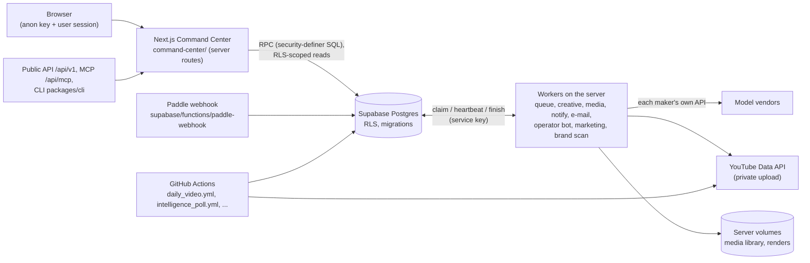

# Nightshift: architecture

The current system map, written from the code on `main` (checked 2026-11-12, after #690-#694). The code
is the source of truth. Where this page could not confirm something from the repository (live switch
values, what the live database holds, whether a scheduled workflow is producing output), it says
**not verified**. An unknown is not a number, and an unmeasured thing is not zero.

Nightshift is a multi-model creative studio with a video pipeline attached:

- **Studio.** A signed-in person generates images, video, speech, sound and music with models that the
  model registry lists, edits video in a browser editor, and keeps the results in a media library.
  Every paid job is quoted, held, then captured or refunded.
- **Pipeline.** The original autonomous YouTube channel operator: pick a topic, research, write,
  fact-check, narrate, render, check, upload as private, learn from the results.
- **Ways in.** The web app (the "Command Center"), a public REST API, an MCP server and a CLI.

The **historical** section at the end lists what earlier versions of this page said that is no longer true.

---

## 1. Components and how they talk

| Layer | What runs | Where to look |
| :-- | :-- | :-- |
| Browser | React pages; Supabase **anon key** and the person's session only. No service key reaches the web app: the only `SUPABASE_SERVICE_KEY` mention under `command-center/` is a comment in `lib/server/github-secrets.ts` | `command-center/lib/supabase/client.ts` |
| Web server | Next.js App Router. Server routes validate input, then call a database function under the caller's own session. The channel travels in the URL (`/{channel}/{section}`), and `middleware.ts` puts it into request headers | `command-center/app/api/`, `command-center/lib/server/`, `command-center/middleware.ts` |
| Database | Supabase Postgres: tables under RLS, `security definer` functions that do every write that matters, append-only logs | `supabase/schema.sql`, `supabase/migrations/` (0001-0139, 122 files) |
| Workers | Python, one Docker image (`Dockerfile.worker`), one compose service per job type, each claiming rows from the database with the service key | `tools/*_worker.py`, `deploy/docker-compose.yml` |
| Vendors | Studio adapters call each maker's own HTTPS endpoint (see section 2) | `modules/capabilities/` |
| Scheduler | GitHub Actions for the pipeline schedule, the intelligence poll, probes, alerts and CI | `.github/workflows/` |

A browser never publishes, renders or spends on its own. A button writes a request row through a
database function and stops. A worker carries the request out after the database has checked it again.

## 2. Model registry and adapter layer

| Piece | Holds | File |
| :-- | :-- | :-- |
| Registry file | Static facts per model: capabilities, inputs, sizes, durations, adapter, vendor model string, documentation quality, `credit_unit`, entitlement, `terms_gate`, limits, probe call. 85 entries today, over 21 capabilities (`t2i`, `edit`, `t2v`, `i2v`, `tts`, `sfx`, `music`, `upscale`, `captions`, `dub`, ...) | `schemas/model_registry.json`, validated against `schemas/model_registry.schema.json` by `modules/model_registry.py` |
| Database half | `model_registry.availability` (`hidden`, `beta`, `ga`, `disabled`), `verified_at`, `model_probe_runs`. CHECK constraints refuse `beta` or `ga` without `verified_at`, with an open `terms_gate`, or without a `credit_unit` | `supabase/migrations/0035_model_registry.sql` (lines 97-124) |
| Probe | One cheapest real call per model with the owner's key. A success sets `verified_at`. `--sync` copies the file's static facts into the database. `--all` skips terms-gated models | `tools/probe_models.py`, `.github/workflows/probe_models.yml` (manual dispatch only) |
| What a person is offered | `sellable_models()`: beta or ga, verified, a positive `credit_prices` row, no open terms gate | `supabase/migrations/0035_model_registry.sql`, `command-center/lib/creative/registry.ts` |
| Owner's switch | Per-model and per-provider on/off (`model_is_available`) | `0124_model_switch.sql`, `docs/MODEL_SWITCH.md`, flag `NIGHTSHIFT_MODEL_SWITCH` |
| Shutdown dates | A model past its announced shutdown is not quoted | `0125_model_shutdown.sql` |
| Operator preview | A platform admin may try a `hidden` model with `"operator_preview": true` in the operator's own credits-exempt organization. No registry entry carries the flag in #694 | `0139_operator_preview.sql` |
| Adapters | One class per vendor API: `submit` (the one paid call) and `poll` | `modules/capabilities/*.py`, `modules/capabilities/base.py` |

The base URLs in `modules/capabilities/*.py` are the makers' own API hosts. The older pipeline has
optional AI b-roll and image providers that are separate from the studio adapters, and one of them is an
aggregator route (`modules/image_providers.py`, the `fal` entry; `modules/avatar_fal.py`). They stay off
unless `CHRONOS_ENABLE_IMAGE_GEN`, `CHRONOS_ENABLE_VIDEO_GEN` or `NIGHTSHIFT_AVATAR_ENABLED` is set
(`config.py:98`, `config.py:170`, `modules/avatar.py:320`). The live values are not verified.

Which models are `beta` or `ga` on the live database today: **not verified** (the database is not
readable from the repository).

## 3. The creative job money path

Credits are the site currency (migration 0020: `credit_accounts`, the append-only `credit_transactions`
ledger, `credit_reservations` for holds, `credit_prices`). A studio generation is a `creative_jobs` row
(migration 0036), written only by these functions:

| Step | Function | What it does |
| :-- | :-- | :-- |
| Quote | `quote_creative_job` / `creative_price` | Price = max(quantity x credits_per_unit x (1 + margin), job_minimum), from the `credit_prices` row the model's `credit_unit` names. No unit or no row: `unpriced`, never 0. The client's number is never used |
| Create | `create_creative_job` | One transaction: lock the organization's credit account, quote again, refuse a price above what the person confirmed (`max_credits`), `reserve_credits` (the hold equals the quote), insert the job. Idempotency key per request |
| Claim | `claim_creative_job` | `FOR UPDATE SKIP LOCKED`, heartbeat, bounded re-queue |
| Run | `advance_creative_job` | `submitting` is recorded before the paid call, and the provider task id before any polling. A job that already has a task id is polled, never submitted again |
| Settle | `finish_creative_job` | Success: `capture_credits` up to the hold. Failure, cancel, expiry or a lost worker: `release_credits`. Settlement and the status change happen in one transaction |

The worker side is `modules/creative_worker.py` (`tools/creative_worker.py`). In exact mode only the chosen
model runs. Routed modes (0075) may move to another compatible model only when the vendor provably took
nothing, and never to a dearer one than the hold. Server entry points: `app/api/creative/quote`,
`app/api/creative/jobs`, and `/api/v1/creative` for API keys.

The same quote, hold, capture and release shape is used by pipeline runs (`render_jobs`, 0017, 0020, 0041),
paid editor exports (0132, 0136, below), brand scans (0133) and the public API's own cent balance
(`api_ledger`, 0031). `NIGHTSHIFT_CREDITS_ENFORCE` decides whether the worker requires a hold for a
customer's pipeline run. The operator's default organization is credits-exempt.

Plans and packs: plans, entitlements and their keys are data (0034, `command-center/lib/plans.ts`).
Payments arrive through the Paddle webhook, a Supabase Edge Function (`supabase/functions/paddle-webhook`).
The launch checklist records the pricing page on Paddle's sandbox (`docs/LAUNCH_CHECKLIST.md`, owner item 3).
Whether that is still the case: **not verified**.

## 4. The editor: document, parity and render

An edit is data: a timeline document (`schemas/timeline.schema.json`, version 1) saved as a revision of
an editor project (migration 0054). The browser edits the document. The server checks it and saves it.
A worker renders it with ffmpeg.

| Concern | TypeScript (browser and route) | Python (worker) |
| :-- | :-- | :-- |
| Document model and edit tools (trim, split, roll, slip, slide, ripple, speed and speed curves, colour, masks, overlays, shapes, text, captions, voice-over, effects, transitions) | `command-center/lib/editor.ts`, `lib/editor*.ts` | `modules/timeline.py` |
| Validation | `validateTimeline` in `lib/editor.ts`, run by the save route (`app/api/editor/projects/[id]`) before the database is asked; `lib/server/editor-guard.ts` adds the rate limit and body cap | `timeline.validate` |
| Shared cases | `command-center/tests/editor-timeline.test.ts` | `tests/test_editor_doc_cases.py` |
| Speed curves | `lib/editorSpeedRamp.ts` | `modules/speed_ramp.py` |

Both validators run the same documents from `samples/timeline_doc_cases.json`, so a change to one that
the other does not make fails CI. The database function `editor_doc_problem` checks only `asset_id`
values (they must be the organization's own live files) and size. Every render field, its limits and
its default are listed in [editor-render-fields.md](editor-render-fields.md).

Render path: `request_editor_export` → the media worker's export thread (`tools/media_worker.py`) →
`modules/editor_export.py` → `timeline.validate` → `modules/timeline_render.py` (a `RenderSpec`) →
`modules/render_backend.py` (ffmpeg, one process, wall-clock limit) → a new library file
(`store_generated`) → `finish_editor_export`. Files are read by asset id only, never by a path taken from
the document. Text goes through an ASS file (`modules/ass_captions.py`), never into an ffmpeg argument.
The browser preview is an approximation, and the ffmpeg export is the reference.

Export frames and money:

- Other frames from a closed list (multi-ratio), migration 0129, flag `NIGHTSHIFT_MULTI_RATIO_EXPORT`.
- 1440p and 4K, migration 0132, flag `NIGHTSHIFT_HIRES_EXPORT`. They are sold per started output minute,
  and both prices are seeded NULL, which means not on sale.
- Exports up to 1080p, migration 0136. They stay free while `credits_per_minute_1080p` is NULL, and are
  quoted and held per started minute once the owner sets it. The quote uses the rendered length with
  speed curves integrated. A security lab test compares it with Python over 2000+ seeded documents.
- Whether the live database has any of these prices set: **not verified**.

An export ends as a library file and nothing else. No code path takes a library file or an export to
YouTube or to a social account (0054 header: "Publishing stays where it was").

The parity plan the editor builders follow is [research/premiere-parity.md](research/premiere-parity.md).

## 5. Publishing and the approval gate

Publishing applies to **pipeline videos** (the `videos` table). Every layer below is in the code on `main`:

| Layer | What it does | File |
| :-- | :-- | :-- |
| Privacy default | `YOUTUBE_PRIVACY` defaults to `private` (`config.py`), and so do the scheduled run and the manual dispatch input (`daily_video.yml`) | `config.py`, `modules/run_request.py` |
| Early hold | A fact-check that would block the gate stops the run before the voice and the render are paid for | `main.py` (`publish_gate.evaluate_fact_check`, `HeldBeforeRender`) |
| Publish gate | Runs on every finished video before any upload: QC report (`modules/video_qc.py`), fact-check results, grounding, claims, title. A blocked video is kept on disk with a `videos` row and a `publish.blocked` event | `modules/publish_gate.py`, `main.py` (around "Pre-publish gate") |
| Auto publish | Per-channel switch on top of the gate: an allowed video is uploaded now, or held for a person | `channels.auto_publish` (0004, `default false`); see the note below |
| Two-person rule | A channel with `require_two_person_publish` needs a second admin's approval before a public upload | `modules/publish_approval.py`, migration 0009 |
| Approval of one cut | `approve_video_publish` records who approved which exact file (sha256), until when (24 h), with what acknowledgement. It does not change privacy | migration 0112 |
| Publish when approved | A second per-channel switch, off by default, that only a workspace admin can turn on through an audited function. The approval then queues one request, which the queue worker carries out only after asking the database again. The worker switch `NIGHTSHIFT_VISIBILITY_PUBLISH` defaults to `off` (`modules/visibility_publish.py:607`) | migration 0116, `modules/visibility_publish.py`, `docs/APPROVE_PUBLISH_1B.md` |
| Cross-posting | "Publish to platforms" writes `publish_requests` rows. The queue worker re-asks `publish_request_refusal` (gate passed, approved, two-person rule met) and posts the master render only | migration 0029, `modules/social_publish.py` |

Note on the auto publish default: the database column defaults to `false`, but `ChannelContext` reads a
**missing** key as `true` (`modules/channels.py:231`, `:353`). For a channel defined in `channels.json`
without the key, an allowed video is uploaded (as private unless the run asks otherwise).

`modules/pipeline_stages.py` (`PipelineStateMachine`) and `tools/approve_run.py` are an audit trail only.
Nothing in the upload path reads them.

## 6. The autonomous pipeline and the intelligence loop

### Pipeline (`main.py`, one run for one channel)

Topic (`topic_manager`, vetted by `topic_gate`) → research → script (`script_engine`) → fact-check and
grounding → voice (`audio_mixer`, with `verify_voice` refusing a substitute voice) → media (stock, and
optional AI b-roll) → subtitles → thumbnails → render → QC → publish gate → upload or hold. Per-channel
settings travel on `ChannelContext` (`modules/channels.py`) and are never read from a global.

Two run backends, chosen on the web server by `NIGHTSHIFT_RUN_BACKEND` (`command-center/lib/runBackend.ts`):
`actions` (the default) dispatches `.github/workflows/daily_video.yml`, and `queue` writes a `render_jobs`
row for `tools/queue_worker.py`. The same workflow runs on a cron every 15 minutes and starts a channel
when its slot is due (`tools/list_channels.py`). `NIGHTSHIFT_PIPELINE_PAUSED` stops the scheduling
(`modules/pipeline_pause.py`). Whether the schedule is paused or producing videos live: **not verified**
(the Actions history is not readable from here).

Render engines (`config.py:384`): `CHRONOS_RENDER_BACKEND` defaults to `moviepy`. `ffmpeg` is the
opt-in declarative path (`modules/render_backend.py`), with fallback to MoviePy. The Remotion scene
renderer (`video-engine/`, `modules/scene_remotion.py`) is **off by default**: it needs
`CHRONOS_SCENE_RENDER=1` and `CHRONOS_REMOTION=1`. The editor export always uses the ffmpeg engine.

Local run history is still a SQLite file, `history/chronos.db` (`modules/state_store.py`). It is mirrored
to Supabase (`modules/supabase_sync.py`), and Supabase is what the Command Center reads. On GitHub-hosted
runners the file lives only for one job, restored from the Actions cache.

### Intelligence loop

`.github/workflows/intelligence_poll.yml` (cron `0 20 * * *`) runs `tools/run_intelligence_poll.py`:

1. own-channel analytics, competitors and trending (`modules/intelligence_poller.py`);
2. comments fetched, classified and aggregated into demand;
3. `TopicRecommender` suggestions queued into `ContentPlanner` (a JSON file queue);
4. the feedback engine (`modules/feedback_engine.py`) scores topics, and `TopicManager` reads them on the next run.

| Part | State | Evidence |
| :-- | :-- | :-- |
| Poll, comments, recommender, feedback | Wired in code, scheduled | `tools/run_intelligence_poll.py`, `modules/topic_manager.py:159`, `:689` |
| Agent autopilot topic choice | Off unless `CHRONOS_AGENT_AUTOPILOT` is on | `config.py:161`, `main.py:1072` |
| Publish score, packaging lint | Advisory only, and never gate | `main.py` after the gate |
| `PipelineStateMachine` approval chain | Audit only | `tools/approve_run.py` docstring |
| Command Center intelligence pages | Read-only, derived at read time | `docs/INTELLIGENCE.md` |
| Series Factory (`SERIES_FACTORY`) | Planner, tables and worker exist and are dark: `NIGHTSHIFT_SERIES_PLANNER` (worker), `SERIES_FACTORY_ENABLED` (page), and `request_series_plan` is granted to nobody | `modules/series_plan_worker.py`, [SERIES_FACTORY.md](SERIES_FACTORY.md) |

Whether the poll returns data on the live channel: **not verified**.

## 7. Auth and roles

| Who | How it is decided | Where |
| :-- | :-- | :-- |
| Signed-in person | Supabase Auth (e-mail and password, or Google). The sign-up form requires a separate "18 or older" box (`command-center/lib/signup.ts`, `age_required`) and the Google button's line says the same. This is a form check. No migration stores the confirmation | `command-center/app/signup/page.tsx`, `docs/SIGNUP_SETUP.md` section 8 |
| Organization member | `org_members.role` is one of owner, admin, editor or viewer. RLS asks `accessible_org_ids(min_role)` / `is_org_member` first | migration 0018 |
| Platform owner and admins | The `app_members` roster. `is_platform_admin()` gives platform-wide access, and the default organization (`...0001`) is the operator's own and is credits-exempt | migrations 0018, 0033 |
| Owner second factor | Owner pages need a fresh authenticator code while `NIGHTSHIFT_ADMIN_MFA=enforce` | `docs/security/ADMIN_MFA.md` |
| Owner actions | Credit grants with caps, price changes with history, roster changes that cannot remove the last owner. Each one is audited in the same transaction. Shipped dormant behind `NIGHTSHIFT_OWNER_RPC` | migration 0107 |
| API key | `nsk_live_...`, minted by the database, stored as SHA-256 only, and acting as its creator inside one organization | migrations 0031, 0040, 0042, [API.md](API.md) |
| MCP | API key, or OAuth sign-in behind `MCP_OAUTH_LIVE` | [MCP.md](MCP.md) |

## 8. Security architecture

- **RLS everywhere, writes through definer functions.** Tables are read under RLS. State changes that
  matter (credits, jobs, approvals, exports, tokens) go through `security definer` functions that check
  the caller, the organization and the role, and refuse with a stable reason word (`creative_refuse`,
  `NS4xx` codes).
- **Append-only records.** `credit_transactions` (0020, a trigger refuses edits), `creative_job_events`
  (0036, a trigger refuses update and delete), `security_events` (0107; the owner role cannot rewrite it
  either), `api_ledger` (0031).
- **Secrets.** Keys typed in the Command Center are sealed to the repository's public key, PUT to
  GitHub Actions secrets and dropped (`command-center/lib/server/github-secrets.ts`). Customer channel
  tokens live in Supabase Vault (0022, `modules/channel_tokens.py`). The worker scrubs secrets from logs
  (`modules/log_redaction.py`).
- **Findings ledger.** Every finding, with its fix and the test that fails if it comes back:
  [security/LEDGER.md](security/LEDGER.md). Process: [security/README.md](security/README.md).
- **Security lab.** `tests/security/` (149 files) runs against a real PostgreSQL 16 in
  `.github/workflows/security.yml`. That job applies every migration in order to a fresh database and
  fails, rather than skips, when the database is missing (`NIGHTSHIFT_SECURITY_REQUIRED`).
- **Migrations.** Additive and numbered. A merged migration is never edited. Migration headers marked
  "LIVE ON APPLY" say that merging applies them to the live database. The integration that does this is
  configured outside the repository (not verified from code). `tests/test_migration_prerequisites.py`
  checks the guards. See [MIGRATIONS.md](MIGRATIONS.md).
- **Web.** CSP ships report-only by default (`CSP_MODE`, [security/CSP.md](security/CSP.md)). The Paddle
  webhook verifies the signature on a size-capped body.

## 9. Deploy: what runs where

| What | Where | How it gets there |
| :-- | :-- | :-- |
| Command Center (`web`) behind Caddy | A dedicated server ([DEPLOY_AX42.md](DEPLOY_AX42.md)), Docker Compose | `.github/workflows/deploy_web.yml` on a push to `main` that touches `command-center/`, `deploy/` or the worker image, then `deploy/remote-deploy.sh` over SSH |
| Pipeline worker, media worker (uploads and editor exports) | Same server, compose profile `worker` | Same run, while the repository variable `NIGHTSHIFT_WORKER` is `on` |
| Creative worker | Same server | Also needs `NIGHTSHIFT_CREATIVE_WORKER=on` |
| Notify, e-mail, operator bot, marketing, brand scan workers | Same server, one profile each | `NIGHTSHIFT_NOTIFY_WORKER`, `NIGHTSHIFT_EMAIL_WORKER`, `NIGHTSHIFT_OPERATOR_BOT`, `NIGHTSHIFT_MARKETING_WORKER`, `NIGHTSHIFT_ADS_BRAND_SCAN`. Anything other than `on` removes the container and its env file |
| Media library | A Docker volume on the server (`media`). The compose file says it is not a backup | `deploy/docker-compose.yml` |
| Database, auth, Edge Functions | Supabase | Migrations on merge; functions under `supabase/functions/` |
| Pipeline (default backend), intelligence poll, probes, alerts, CI | GitHub Actions | `.github/workflows/` |

**Feature flags are repository variables read at deploy time.** `deploy_web.yml` copies `vars.*` and
`secrets.*` of the GitHub Environment `production` into the server's env files on every run, so a flag
changes on the next deploy. The web app's flags (defaults empty, which means off, in
`deploy/.env.web.example`) include `NIGHTSHIFT_MULTI_RATIO_EXPORT`, `NIGHTSHIFT_HIRES_EXPORT`,
`NIGHTSHIFT_IMAGE_EDITOR`, `NIGHTSHIFT_REGION_EDITOR`, `NIGHTSHIFT_CHARACTER_STUDIO`,
`NIGHTSHIFT_ADS_FACTORY`, `NIGHTSHIFT_ADS_BRAND_SCAN`, `NIGHTSHIFT_RESULTS_DASHBOARD`,
`NIGHTSHIFT_MODEL_SWITCH`, `NIGHTSHIFT_MODEL_KEYS`, `NIGHTSHIFT_AGENT_DRAFTS_ENABLED`,
`NIGHTSHIFT_MARKETING_POSTS`, `SERIES_FACTORY_ENABLED`, `CUSTOM_VOICE_ENABLED`, `MCP_OAUTH_LIVE`,
`DEV_CLI_PAGE`, `PUBLISH_ON_APPROVE_RELEASED` and `NIGHTSHIFT_OWNER_RPC`. Their live values are **not
verified**: the repository's variables are not readable from here.

## 10. Where to look

| Question | Start here |
| :-- | :-- |
| What a model can do and whether it is sold | `schemas/model_registry.json`, `modules/model_registry.py`, `0035_model_registry.sql`, `command-center/lib/creative/registry.ts` |
| How a vendor is called | `modules/capabilities/<vendor>.py`, `modules/capabilities/base.py` |
| How a generation is paid for | `0036_creative_jobs.sql`, `0020_credits.sql`, `modules/creative_worker.py` |
| Editor document and render | `command-center/lib/editor.ts`, `modules/timeline.py`, `modules/editor_export.py`, `docs/editor-render-fields.md` |
| Export pricing | `0132_editor_hires_export.sql`, `0136_editor_export_paid_1080p.sql`, `docs/HIRES_EXPORT.md` |
| Why a video did or did not upload | `modules/publish_gate.py`, `main.py`, `modules/publish_approval.py`, `modules/visibility_publish.py` |
| Pipeline schedule and run | `.github/workflows/daily_video.yml`, `tools/list_channels.py`, `tools/queue_worker.py` |
| Intelligence | `tools/run_intelligence_poll.py`, `modules/feedback_engine.py`, `docs/INTELLIGENCE.md` |
| Who may see what | `0018_organizations.sql`, `tests/security/` |
| Deploy and flags | `.github/workflows/deploy_web.yml`, `deploy/docker-compose.yml`, `deploy/.env.web.example`, `deploy/.env.worker.example` |
| Plans and payments | `command-center/lib/plans.ts`, `supabase/functions/paddle-webhook`, `docs/BILLING_PLANS.md`, `docs/PADDLE_SETUP.md` |
| Public API, MCP, CLI | [API.md](API.md), [MCP.md](MCP.md), [CLI.md](CLI.md) |

## Historical: what earlier versions of this page said

| Earlier claim | Now |
| :-- | :-- |
| The two halves talk only through "a SQLite database and JSON files" | Supabase Postgres is the system of record for the product. SQLite remains as the pipeline's local run history, mirrored to Supabase (section 6) |
| "Zero GitHub Actions workflow runs have occurred" | Out of date. `daily_video.yml` itself cites 268 scheduled runs. Current run history is not verified here |
| "Stage 8 — Upload (unconditional; publish gate NOT enabled)" | The publish gate runs before every upload and only ever blocks (`main.py`, `modules/publish_gate.py`). Approvals and auto publish sit on top of it (section 5) |
| `PipelineStateMachine` approval "not wired" as a pending follow-up | It is still not wired, by design: it is an audit trail. The gate and the approval functions are what decide |
| Series Factory "unwired: no route, table or workflow uses it" | Tables (0120, 0122, 0127), a worker job and a page exist. All of them are dark behind flags (section 6) |
| Remotion as part of the render | Optional and off by default (section 6) |
