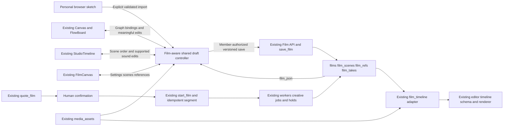

# Project-bound Canvas–Timeline contract proposal

Phases A–C only. Baseline main f985b3af. Companion evidence: AUDIT_CANVAS_TIMELINE.md. Types below illustrate missing contracts for approval; they are not deployed endpoints, migrations or a new project schema.

## Authority and dataflow



One canonical project is `films.id`, owned by its organization and optional channel. Canvas dependencies are not Film scene order. Browser state, signed preview URLs and draft AI plans never become money or publication authority.

## Proposed minimal graph attachment

Reuse existing CanvasNode/CanvasWire, not a second graph model. Add only missing stable binding metadata and a bounded persisted document under Film ownership after schema approval:

```ts
type ProjectBinding =
  | { kind: "scene"; sceneId: string }
  | { kind: "take"; takeId: string }
  | { kind: "job"; jobId: string }
  | { kind: "asset"; assetId: string };

type ProjectGraphAttachment = {
  schemaVersion: 1;
  filmId: string;
  contentVersion: number; // existing films.version
  layoutRevision: number; // proposed optimistic cosmetic revision
  graph: {
    nodes: Array<Omit<CanvasNode, "jobId" | "assetId" | "assetKind" | "draft"> & {
      draft?: string; // only for an unbound draft node, never a scene mirror
    }>;
    wires: CanvasWire[];
  };
  bindings: Record<string, ProjectBinding>;
};
```

`bindings` are references to existing rows, not copies of takes, assets, statuses or costs. The server validates all membership, kinds, graph sizes, typed acyclic edges and bindings. Existing single-input behavior remains supported; do not expose arbitrary additional ports before validation and composer semantics exist. Private viewport/selection belongs outside the shared graph document and is keyed by organization + person + Film. Scene position remains in `film_scenes`, never derived from node coordinates or `flowOrder`.

There is exactly one canonical identity binding per bound node. Persisted nodes
omit `jobId`, `assetId` and `assetKind`; the read projection derives those existing
CanvasNode fields from the validated binding and authoritative Film/job/media
rows. A bound scene's draft text comes from the Film scene prompt and cannot be
saved a second time in graph JSON. Unbound draft-node text is canonical only in
the graph until an atomic explicit scene attachment moves authority to Film.
Reject writes containing conflicting mirror fields, multiple binding kinds or
inconsistent scene/take ownership; never select a winner silently. A take binding
is an immutable history reference, not permission to change the scene's selected
version. Input roles remain authoritative Film reference fields; graph wiring
must update those fields and its projection atomically. Quote hashing resolves
these canonical values, not caller-supplied mirrored node data.

Prefer a validated field on existing Film persistence if adequate; evaluate a strictly Film-owned extension only if measured size/concurrency needs justify it. This proposal does not select a migration or authorize creating a table. Do not automatically turn today's private per-person sketch into a shared workspace graph: explicit import/share acknowledgement is required.

## Mutation semantics

| Intent | Authoritative change | Approval consequence |
|---|---|---|
| Move/Tidy cards, zoom, collapse | Cosmetic layout/personal view revision | No content change under the proposed split contract; no job execution. |
| Reorder Film scenes | Existing versioned ordered scene list | Old Film quote becomes stale. Graph order labels update; dependencies stay intact. |
| Change scene prompt/model/duration/reference | Existing content version and supported scene fields | Re-quote and explicit confirmation required. |
| Connect image as supported first frame | Validate asset and input role; update scene input + binding atomically | Invalidate affected content plan; retain already generated take history. |
| Select completed take version | Proposed explicit server operation on existing scene/take history | Invalidate assembly/content quote; never reclassify a client row as completed. |
| Attach uploaded/generated clip | Proposed validated adoption association to existing Film/take/asset records | No generation provider call; price only actual separately requested processing/assembly. |
| Edit arbitrary editor trim/overlap/effect | Existing editor document | Explicit round-trip boundary; cannot silently rewrite Film prompts or infer generation dependencies. |
| AI proposes a scene graph | Unapproved draft only | Saving draft does not approve generation or publication. |

Content changes and their related graph bindings must commit atomically at the expected content revision. Layout-only saves must not change content accidentally. Until that distinction is implemented and reviewed, retain the existing conservative rule that a Film save changes its version and stales its quote; do not keep an old quote by ignoring version refusal.

Use the existing Film shared controller as the only content mutation coordinator. New views subscribe to it rather than each inventing polling and saving. The persisted graph may have a separate revision, but no second job queue, billing ledger, approval database or executor is introduced.

## Recovery and conflicts

Every mutation supplies the revision it read and, where a non-idempotent import/attachment allocates identity, a stable operation key. A timed-out operation is looked up/replayed before allocating again. A 409 keeps the local draft and freezes autosave; show the newer server revision and conflicting fields. Reload/discard and explicit reviewed rebase are distinct actions. Rebase must not resurrect removed references or replace another person's scene list silently. Retain `useFilmProject`'s in-flight edit preservation and rate-limit behavior.

Local import/recovery buffers are scoped to organization, person and Film. An unacknowledged import retains its source. Cross-device durability begins only after server acknowledgement. Unavailable storage, offline, expired session, stale reads, unsupported schema and missing assets have visible states. Never show a local draft as saved remotely.

## Quote and execution boundary

Reuse stored `film_quotes`, version checks, model resolution, `start_film` idempotency, parent segment holds and creative worker accounting. Existing independent card generation remains on its own creative quote/start path; adoption of its output must not regenerate it or add an overlapping generation charge to a Film plan. A Film pipeline cannot be emulated by firing independent cards while its parent reserves the same work.

The approved plan must resolve stable asset/take versions, content revision, exact model IDs, input parameters, quantity, priced lines and price snapshot. Graph dependencies resolved into that content are part of approval. Any material change requires the existing quote to be refreshed and confirmed again; unavailable models stop explicitly. New metadata or imported inputs must be included in existing server hash/version coverage before they may affect a paid worker. No separate client-generated approval flag is authoritative.

Card creation and whole-Film starts need explicit human interaction at their existing confirmation boundary. Unknown network outcomes reconcile/replay the original idempotency key, preserving its payer and frozen terms. No silent extra generation, replacement model, paid retry beyond approved allowance, public publishing or automatic approval follows from a graph edit.

For later MCP work, reuse business validation through token-scoped adapters, not direct browser-cookie RPC assumptions or elevated service-role calls. Current Film read/save/quote/start roles remain viewer/editor/editor/admin respectively; a tool token or agent-supplied maximum spend is not proof of human approval. Public publication retains its separate existing gate.

## Decisions that implementation approval must settle

1. Exact Film-owned graph storage field/extension and revision rules, with bounded serialization and migration review.
2. Whether project graph is workspace-visible on explicit save, and which members may edit; keep personal sketches private until then.
3. Supported asset adoption and take-selection subset, including uploaded narration and video duration/rights validation.
4. Film-to-editor boundary: preserve Film-to-render projection first; arbitrary editor-to-Film round trips require explicit supported transforms.
5. Reconciliation of PR793 and pending P0 billing dependencies before overlapping changes.

The acceptance matrix in AUDIT_CANVAS_TIMELINE.md is required for the approved subset. All unimplemented operations remain clearly unavailable rather than reporting success.
