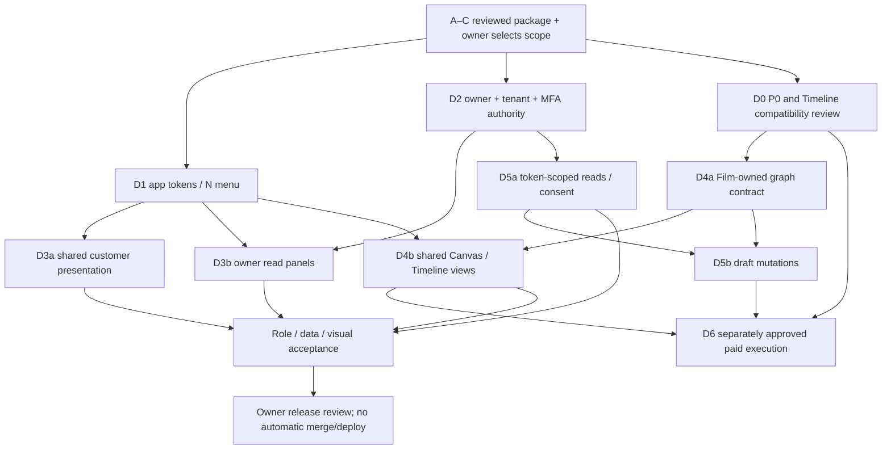

# Premium UI and Studio integration: implementation proposal

Status: Phase C, for owner approval. No Phase D work has started. Source and
evidence boundaries are in [README](README.md). This is a file-level work plan,
not application code, SQL, API contracts already shipped or a release request.

## Delivery slices

| Slice | Proposed outcome | Existing source to extend | Dependency / exclusions |
|---|---|---|---|
| D0: baseline and correctness | Reconcile frozen main with reviewed P0 and Timeline repairs; record final heads and actual function overlap. | Existing PRs 787/796, 750/798, 786/797, 793 and migration tests. | No automatic merges. Coordinate 0175–0178 and pending 0176; Planner's stale 0178 reservation cannot allocate a second migration. |
| D1: app presentation foundation | Premium layered navy/violet and accessible light theme, existing brand and navigation, single top-right N dropdown on desktop/phone, compact theme/settings/sign-out. | `command-center/app/globals.css`; `components/account/AccountMenu.tsx`; `components/Header.tsx`; `components/shell/CustomerSidebar.tsx`; existing UI primitives and i18n. | First recommended scope. No schema, provider integration, new execution, finance DTO or direct payment. No new owner entry until D2 owner capability is trustworthy; existing Mobile/Desktop preference is separate. |
| D2: owner/tenant capability contract | Owner-only Command access and DTOs, MFA on sensitive operations, fail-closed role/error behavior, ordinary-user and owner-Personal tenant privacy. | `lib/auth/org-roles.ts`; `lib/security/admin-mfa.ts`; existing server guards, owner RPCs, grants/RLS and shell capability serialization. | Approve exact authority/caller migration first. Narrowing new UI alone does not remove broader existing direct DB access. No service-role browser/token bridge, no new role or impersonation. |
| D3a: customer presentation/parity | Restyle dashboard, Create, Studio, library/editor/channels/inbox/credits/settings using existing handlers and safe read facts. | `components/home/HomeHub.tsx`, `RecentStrip.tsx`; `components/studio/StudioHome.tsx`; customer route map and current shared components. | D1. Missing counts/aggregates remain unavailable until a bounded authorized reader exists. No misleading active plan, approximate total or fake success. |
| D3b: Owner Command read panels | Seven reference screen compositions using validated owner DTOs, aggregate privacy, complete/partial/unknown metrics and verified provider billing destinations. | Existing command-center, customers and billing pages; `components/billing/*`; `lib/billing.ts`; existing payment/provider cost sources. | D2. Fix payment-source/environment/fee/refund/period coverage before reporting net revenue/profit. No auto top-up, merchant refund, infrastructure control or secret readback. |
| D4a: durable project binding | Film-owned bounded graph/bindings, separate layout revision, explicit local import, cross-device recovery and conflict behavior. | Existing `films`, `film_json`, `save_film`, `useFilmProject`, `lib/studio/canvas.ts`; approved minimal persistence extension only. | D0 and separate schema/API approval. No generic second projects/takes store. Keep standalone private sketches and retain source until acknowledged. |
| D4b: shared Canvas/Timeline workspace | Same project/controller/selection across existing Canvas, Film editor and Timeline; graph inputs remain distinct from chronology; existing assets/takes adopted without regeneration. | `StudioCanvas.tsx`, `FlowBoard.tsx`, Inspector/GeneratePanel, `FilmCanvas.tsx`, `StudioTimeline.tsx`, `lib/studio/timeline.ts`, Film API and renderer projection. | D4a and PR793 reconciliation. General trim/effect/editor round trips remain explicit unsupported boundaries until mapped. No new render engine or fan-out executor. |
| D5a: MCP scoped reads | Existing tool names reused; project/asset/timeline/budget reads plus explicit OAuth consent, tenant-aware adapters and honest availability. | `lib/api/mcp.ts`, `mcp-oauth.ts`, `operations.ts`, `lib/oauth/config.ts`, current discovery/consent and read serializers. | Approved M1 scope. Existing Film reads can ship before graph persistence only while graph state honestly says unavailable. Customer reads cannot expose owner telemetry. |
| D5b: MCP draft changes | Validate/apply typed scene/project patches and supplied drafts with expected revisions and operation keys; no hidden LLM, spend or send. | Existing Film/Canvas validation and token-authorized adapters specified in MCP contract. | D4a/D2 where applicable and explicit new scope consent. No arbitrary JSON mutation/RPC proxy. |
| D6: optional paid project/agent orchestration | Bound quote and independently verifiable human approval through existing Film/card execution, cost admission, failure caps and emergency fencing. | Existing Film quote/start, creative operations, current workers and holds; reviewed Planner contracts. | Separately approved later scope, P0 reconciliation and complete pricing/payer contract. AI Brain P1 remains paused. Not part of the proposed D1 approval. |

Each approved slice gets an isolated feature branch and small draft PR. A slice
may be split further for review; it cannot silently absorb deployment, pricing,
schema, supplier procurement or a new paid capability.

## Dependencies and useful parallelism

D1 visual work, D2 authority analysis and MCP read-contract work are independent
only when shared source ownership is agreed. One integrator owns AccountMenu,
layout/auth props, dictionaries and global tokens; do not let independent agents
overwrite these shared files. Business changes and their tests stay with their
own PR. Review scope and snapshot must be explicit when one PR stacks on another.

## Graph persistence decision record

Choose Film identity and reuse CanvasState/CanvasWire. Proposed missing metadata
is described in [Canvas–Timeline contract](CANVAS_TIMELINE_CONTRACT.md). Do not
allocate a migration number or add a generic project table in this phase.

Evaluate a bounded Film-owned metadata field first; select a separate strictly
Film-owned extension only if measured size, write contention or independent
revision needs justify it. Before approval, specify maximum node/wire/payload
size, binding validation, stale schema refusal, current organization/person
recovery namespace and migration/backfill/rollback evidence. No guessed bound
is represented as a current enforced limit.

Content/inputs/selected takes/chronology affect existing Film version and paid
approval. Cosmetic coordinates and personal view preferences must not silently
modify content; split revisions require reviewed backend support. Until then,
existing conservative quote invalidation stays in force. No client flag exempts
a save from version checks. Assets and takes remain referenced immutable records,
not copied raw URLs, completed statuses or local credit claims.

## MCP delivery contract

The [dedicated MCP specification](MCP_EXPANSION_SPEC.md) is a complete workstream,
not a checkbox in the visual redesign. Current fourteen API-key and eight OAuth
tools remain documented separately. New consent cannot inherit owner authority
or bypass model `web_only` restrictions. A read or save must not hide a paid AI
request. Paid execution requires a backend-verifiable approval record; tool
arguments such as `confirmed: true` or `max_credits` cannot create one.

The first MCP implementation proposal is M1 bounded reads only. M2 mutations
and M3 execution remain later approvals. Optional M4 owner telemetry requires a
separate owner-only resource/audience and fresh MFA, not a broad customer token.
No tool receives shell, SQL, SSH, Docker, keys, schema, deployment or refund powers.

## Acceptance and evidence to collect in Phase D

| Category | Evidence required for the approved slice |
|---|---|
| Visual/reference fidelity | Annotated before/reference/after for all affected screens, widths 375/390/430/768/1440/1920, both themes; EN/RU/UZ long text and menu states. All ten screen IDs remain traceable through the reference manifest. |
| Brand | Existing SVG/vector masters byte-identical; correct mark/wordmark use, no copied reference-logo substitutes; account N trigger does not remove profile/photo settings. |
| Accessibility | WCAG AA text/control contrast, visible focus, keyboard menu/canvas/reorder alternatives, focus-safe confirmation, 44px target goal, reduced motion, phone pan/scroll and screen-reader names. |
| Functional parity | Every visible control has an existing validated action or an explicit unavailable reason. Preserve full editor, library, account, plan, channel and inbox capabilities. No decorative success handlers. |
| Role/privacy | Owner versus org admin/platform admin matrix; user/direct owner URL/API/RSC prefetch denial; mode preference grants nothing; tenant switch clears stale data; owner Personal uses the customer implementation. |
| Data truth | Unknown !=0; source/as-of/currency/period/coverage fields; no fake GPU/Stripe/compliance/active plan; provider balance observation differs from estimate/manual confirmation. |
| Money | Existing price quote/hold/settlement/returns; one parent payer; unknown cost blocks start; immutable approved inputs; no duplicate start on click/retry/concurrency; no double-counting provider deposits as usage expense. |
| Project integrity | Dependencies versus chronology tests; stable scene/take/asset identity; no re-generation on adoption; atomic versioned writes; 409 local recovery; delayed reads do not regress state; across-device reopen only after server acknowledgement. |
| MCP | Legacy tool sets/scopes preserved; explicit re-consent for added scopes; wrong audience/revoked token/cross-tenant/over-budget/forged approval denied; resources/prompts contain no privileged execution or untrusted instructions. |
| Failure and exposure | Provider errors/timeouts/uncertain outcomes keep honest statuses and bounded retries; no silent substitution, publish, auto-reply or payment; kill fences preserve reconciliation, not fake cancellation/refund success. |

Use synthetic owned fixtures and mocked providers for application/security tests.
Application preview screenshots must be labelled fixture-based; do not capture
private production accounts or present fixture charts as live dashboard data.
An absent provider or schema is an unavailable state, not a reason to invent a
new source or open a feature flag. Do not run paid supplier benchmarks as part
of visual QA. Application builds/tests apply only after an approved application
change; they are not claimed completed by this documentation package.

## Release and rollback boundaries

Visual rollback reverts presentation files; it cannot automatically reverse a
financial migration, reopen known billing gaps or restore incompatible workers.
Schema/permission changes need their own forward/rollback plan and human review.
No rollback deletes paid history or discards unresolved provider outcomes.

Before release review, re-read main and all dependency heads, inspect combined
source/function overlap and run checks on that final head. A draft PR or merged
SQL file is not proof of applied production state. Human approval is required
separately for implementation scope, merge, deployment and migrations where
applicable; approving D1 grants none of those later permissions.

## Concrete first approval scope

**D1 only:** signed-in visual token overrides and portal scoping, exact existing
brand usage, reused AccountMenu with top-right N trigger at all widths, compact
theme controls, Settings/sign-out/locale preservation, existing navigation and
device preference retained. No database, new owner data access, supplier swap,
tariff change, paid operation, graph persistence or MCP scope change.

The owner-only destination is added only after the D2 authority prerequisite is
approved and verified. If D1 must present it earlier, it remains absent/unavailable
rather than granting operator/admin access under an owner label. This avoids
making the visual slice depend on an unreviewed authorization migration.

After this package is reviewed, the owner may approve D1, select another bounded
slice, or request a contract adjustment. Implementation must not start merely
because the planning documents exist.
