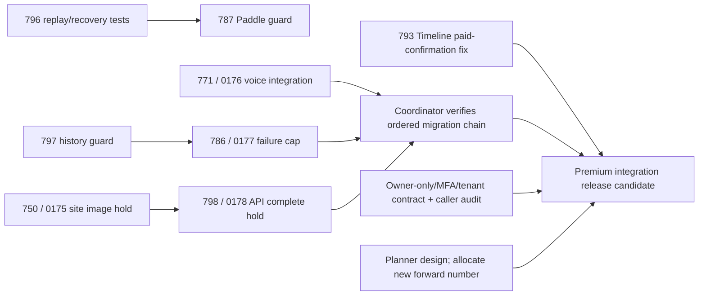

# Premium UI A–C: security, access and dependency contract

Status: **read-only audit and proposed contract only**. No app, repository, schema, configuration, secret, production database, paid generation or deployment change. Master brief read from `/workspace/nightshift-premium-reference/nightshift_premium_ui_reference_pack/CODEX_MASTER_PROMPT.md`; implementation phase D is not authorized. Supabase and Supabase Postgres best-practice skill guidance was applied to RLS, privileged functions and client/session boundaries; no Supabase production queries were made.

## Verified baseline and evidence policy

`git ls-remote origin refs/heads/main` returned `f985b3afd371c0677357670da436ef2074fdb036`. Canonical source checkout: `/workspace/nightshift-premium-ui-plan`. Source references below are relative to that checkout and carry baseline line numbers. Main's migrations end at `0174_rights_acknowledgement.sql`. A feature being present in source, a PR being mergeable, or a UI being rendered does not establish production rollout or current checks passing. GitHub PR metadata was read again for this audit; statuses below are snapshots, not approval to merge.

## A. Current access and privacy findings

### SEC-UI-01 — High requirement gap: existing operator means owner OR platform admin

`command-center/lib/auth/org-roles.ts:160,168–177` derives operator from the server's `is_platform_admin` lookup. `supabase/migrations/0018_organizations.sql:255–258` defines that as platform role in `('owner','admin')`. It is intentionally different from being an admin/owner of one's own customer workspace. `command-center/lib/server/owner-rpc.ts:63` requires `requireRole("admin")`; `0106_video_costs_idempotent.sql:144` permits provider-spend reads to platform admins. These are current authorized staff semantics, not a newly discovered arbitrary-user bypass.

The new brief requires **Owner Command, supplier costs/profit/credential internals owner-only**. Reusing `isOperator()` as an owner-only check would incorrectly admit platform admins. Propose a narrowly named server capability derived from the bound platform **owner** role, not email text, org ownership, menu visibility, cookie or client state. Enumerate each affected page/route/RPC/read/export before changing authority. Align database access too: an owner-only page cannot hide data that a platform-admin REST token can still obtain directly. This is a separately reviewed privilege migration, not a CSS change or blanket replacement of every existing admin check.

Keep existing organization membership/role checks for Personal Studio actions. Do not add an investor role, another authentication implementation, a second customer creative engine or a new ledger. Existing backend organization roles may still authorize current customer actions; they must not confer Owner Command access. Any future staff/support delegation requires its own explicit scope and cannot be smuggled into an owner-only screen by preserving the old broad flag.

### SEC-UI-02 — Current tenant narrowing already exists; preserve it

`command-center/lib/orgs-server.ts:35–46` explicitly distinguishes all workspaces a platform operator may read for support from workspaces they may enter as current. `:87–100` filters bound `org_members` by `user_id`; `command-center/lib/orgs.ts:108` onward narrows switchable organizations to owned memberships plus default org. A failed membership read narrows fail-closed rather than exposing every customer. `requireOrgRole` in `command-center/lib/auth/org-roles.ts:70–97` checks authenticated user, current organization and target membership/role.

By contrast the underlying historical RLS support authority is broad: `0018_organizations.sql:270–294` makes platform owner/admin readable across organizations. Do not infer that the switcher narrowing removes every direct RPC/REST staff permission. Personal Studio data contracts must use the explicit current workspace, matching source-ownership checks, scoped cache keys and safe DTOs; never feed the all-organizations support list into the customer canvas, account menu or library.

The owner's Personal Studio uses the same components, operations and project model as ordinary users. Its active workspace and payer remain explicit; default-org credit exemption is an existing financial rule, not a reason to fake customer balances, grant extra creative tools or silently run a paid trial. Do not implement an owner impersonation token as the mode switch.

### SEC-UI-03 — AccountMenu exists; its current ViewModeToggle is a device switch

`command-center/components/account/AccountMenu.tsx:34` is the reusable account popover/card; `:63` reads fresh `/api/account` data on open. `:265–284` contains usage, credits, invite, settings and sign-out actions. Its mobile controls at `:245–262` include theme and `ViewModeToggle`. **ViewModeToggle selects mobile/desktop presentation (`components/view-mode/ViewModeToggle.tsx:20–36`); it is not Personal Studio/Owner Command.** Do not reinterpret its `ns_view` cookie as authorization.

`command-center/components/Header.tsx:100` contains one account button placement, but the customer mobile header deliberately lacks it (`:115–119`). `AccountMenu` supports a sidebar card variant; customer sidebar renders it. The brief's top-right N avatar on all relevant layouts therefore needs an intentional navigation/placement extension, not an assertion that it is already present everywhere. Keep existing Nightshift brand assets unchanged, accessible labels, Escape/focus restoration, keyboard focus and mobile hit targets. Compact sun/moon controls may reuse theme state; do not create another independent theme preference.

Proposed owner switch appears **only inside the account dropdown** when a trusted server capability explicitly permits it; ordinary users never receive it. A stored mode preference may choose presentation but cannot elevate authority. Forging a mode cookie, URL, localStorage entry or React context must not reveal owner JSON/RSC payloads or invoke owner APIs. Remove redundant header/content mode switches during a separately approved implementation. Do not assume merely hiding the owner menu satisfies server/DB isolation.

`command-center/app/api/account/route.ts:28–68` authenticates, uses the user's anon-key session/current org, returns account/plan/credits/connection metadata, and sets no-store. Keep unknown plan/balance distinct from Free/zero. `command-center/lib/connectedAccounts.ts:11–17` returns connection metadata, not OAuth tokens. Reuse these readers and safe projections; do not add service-role or provider credential fields to AccountMenu props.

### SEC-UI-04 — MFA coverage is conditional; UI redesign cannot claim enforcement

`command-center/lib/security/admin-mfa.ts:30–41` defaults to `warn`; only exact `enforce` activates strict operator challenge/enrollment. `command-center/lib/auth/org-roles.ts:190–198,218–259` wraps operator pages/APIs with current MFA decisions. `command-center/app/(app)/layout.tsx:61` denies production app access when backend configuration is absent; `:95,119` performs operator and MFA lookup. Each sensitive page must still guard itself before reading server credentials: layout denial alone cannot prevent sibling RSC work (`org-roles.ts:201–213`). Example: billing page calls `guardOperatorPage()` at `command-center/app/(app)/[channel]/billing/page.tsx:75`.

`command-center/lib/server/owner-rpc.ts:33–65` uses signed-in user sessions, same-origin protection, role checks and admin POST MFA guard, behind default-off `NIGHTSHIFT_OWNER_RPC`. `0107_owner_safety.sql:145` seeds database `admin_aal2_required=false`; safer audited/capped RPCs exist, but legacy direct grants/price/roster paths are not all revoked in this baseline. An enabled UI flag is not a database AAL2 backstop. Source audit does not read live flags or factors.

Propose a mandatory owner-sensitive-operation matrix: grant/reverse credits, price changes, roster changes, security gate changes, credential updates, provider configuration, model enablement and destructive financial actions require owner authority plus fresh server-verified AAL2, deterministic backend permission checks, reason/idempotency/audit where appropriate. Close direct DB bypass only after legitimate callers migrate, preserve tested owner-controlled break-glass and avoid locking every owner out. Do not grant the browser/service-role privilege to fix a missing permission. No MFA flag, factor or production policy is changed in phases A–C.

### SEC-UI-05 — Keep retail data and private finance/credential data apart

- `0084_margin_private.sql:100–127` restricts raw credit-price margin/notes to platform admins and exposes charged retail rates through `credit_rates`; owner-only scope required by the new brief is narrower still. Do not regress to the older 0020 grants.
- `modules/supabase_sync.py:654–728` omits customer-channel provider USD from the customer-facing cost mirror. Administrator cost coverage cannot be inferred from missing values; private cost reconciliation is a separate data contract, not zero-filled graphs.
- `0106_video_costs_idempotent.sql:125–201` provides an admin-only provider-spend aggregate. Audit its authority before promoting it into the new owner-only DTO; existing admin authorization does not automatically meet the new brief.
- `command-center/lib/supabase/server.ts:14,39` uses anon-key session + verified user. Preserve that boundary in customer pages; keys/secrets must not appear in props, downloaded CSV/PDF, errors, traces or source maps. Public metadata such as a model maker's billing URL is not a credential; links must be verified official destinations and never embed tokens.
- A provider top-up converts cash into prepaid provider balance; it is not automatically an incurred generation expense. Owner profit must distinguish revenue, refunds, commissions, consumed actual/estimated API cost, prepaid balances, OPEX and coverage. No customer receives provider costs, net profit or credentials. Unknown currency/period/invoice coverage remains unknown rather than synthesized from mock images.

## B. Proposed execution and approval contracts

1. Reuse existing authenticated routes, typed operations, assets, creative jobs, Film data and editor. Canvas dependency edges are creative inputs; Film ordering is playback. The local sketch graph (`command-center/lib/studio/canvas.ts`) is not authoritative permission or a durable approval; a saved/tampered localStorage payload cannot cause side effects by itself.
2. Existing Film approval is domain-specific: `0171_films_money.sql:49–51` binds a stored versioned quote/reprices; quote expiry is 30 minutes. Existing publishing approval binds the exact uploaded cut SHA256, true member, acknowledgement and 24-hour expiry (`0112_approve_video_publish.sql:30–51`; `0116_visibility_requests.sql:161–181,278,370–394`). Preserve separate generation and public-publish decisions; earliest relevant expiry wins. An agent or graph node cannot mint human approval.
3. A shared immutable plan approval remains **proposed** in merged design `docs/studio/PLANNER.md`, not an existing executor. Pin canonical plan version, source/take/asset content versions, exact model/settings, policy, payer, quote and expiry. A semantic input/model/price/policy change requires re-quote and reapproval. No silent model substitution. Maintain the existing quote → hold → capture/release model, exact idempotency and parent payer: Film takes must not receive additional child retail holds.
4. Before master-prompt execution, deterministic validation builds an eligible tool catalog from real capabilities, owned inputs, verified availability, terms and prices. Unknown/unavailable functions are disabled with a specific reason. Prompt text, external research/comments/uploads and model-produced JSON never authorize a tool, scope, payment, publish, refund, credential read, deployment or database migration.
5. Proposed global/org/channel stop and atomic cost-admission fences must deny new side-effect permits when killed, stale or unverifiable. Stop does not recall previously authorized/sent HTTP. Keep submitted task IDs, reconcile unknown outcomes, preserve existing bounded customer settlement and separately retain unresolved platform exposure. Do not invent refunds/cancellation success. Existing per-feature switches are not proof of a universal kill switch.

## C. GitHub P0 and Studio dependency snapshot

All open entries below were **draft/open/not merged** when re-read. A historical test summary in a PR body is not newly executed validation or production evidence.

| PR | Current head | Base | Security/release dependency |
|---|---|---|---|
| [787](https://github.com/ruslanjurakulov/nightshift-ai-studio/pull/787) | `6179962111922966d508a12c2708d22573c933ea` | main | Paddle sandbox grant allowlist; Edge Function deployment is separate. Secret/environment pairing must be correct; public test funds must not mint unrestricted customer value. |
| [796](https://github.com/ruslanjurakulov/nightshift-ai-studio/pull/796) | `e5eff7024270648fe51f1a17f35c72dcf7b4e4b5` | `claude/paddle-sandbox-guard` (#787) | Tests/docs clarify unknown environment 503 retry versus sandbox unlisted 200 terminal rejection. Correcting config/list does not revive the same rejected event; audited recovery required, not event deletion/status flipping. |
| [750](https://github.com/ruslanjurakulov/nightshift-ai-studio/pull/750) | `ae4050ac7bd048064574261cae41a61bce31670b` | main | 0175 adds concept image coverage to site/series/MCP; original patch explicitly leaves API-payer coverage incomplete. |
| [798](https://github.com/ruslanjurakulov/nightshift-ai-studio/pull/798) | `ed7a2903839a6b57ee91b6c28bd6d258fe95eb0e` | `claude/peaceful-noether-v5j3kd` (#750) | 0178 adds API-cent image tariff (unseeded), positive base, frozen terms, checked claim, expiry/refund coverage and integration evidence. Database/worker activation and old queued holds need coordinated review. |
| [786](https://github.com/ruslanjurakulov/nightshift-ai-studio/pull/786) | `50408246adfbbed54c5697640bfb9255e2b89c4d` | main | 0177 failed/refused creative-job admission cap; not a universal provider-dollar budget. Preserve workflow/API behavior and exclusions. |
| [797](https://github.com/ruslanjurakulov/nightshift-ai-studio/pull/797) | `7360c242efe38fb9f693f10e558923e883242a75` | `claude/failed-job-cap` (#786) | History regression distinguishes reviewed premerge forms from post-main migration edits; stale refs/divergent mainlines and incomplete history fail closed. |
| [793](https://github.com/ruslanjurakulov/nightshift-ai-studio/pull/793) | `8162e6009a75d2aa408b203a0679465c669e7442` | main | Timeline fixes missed by #790 merge, including confirmation-only paid Start, correct measured/chosen shots and mobile reorder. Resolve before treating Timeline's paid-action UX as release-ready. |
| [771](https://github.com/ruslanjurakulov/nightshift-ai-studio/pull/771) | `395d21527c767f5d8bc685cb0355bb7c0d668158` | main | Voice-to-video Studio integration, 0176, ships dark. Worker capacity, source checks, quote, legal/probe/config gates and #783/#794 coordination remain separate. |

Merged references: [790](https://github.com/ruslanjurakulov/nightshift-ai-studio/pull/790) Timeline merged as `21419d25224c8883337ff0bf975b55b7b5ca21e5`, head `b8c8427d70ea2c89b5fae165ec3aee2055973092`; [791](https://github.com/ruslanjurakulov/nightshift-ai-studio/pull/791) Planner **design only**, merged as `baea09d126e69508e3e5f121f374161dfc254a4b`, head `cbba61a8f21b05d763d7f45aa66422af423ade04`. Neither proves the complete durable Canvas-to-Timeline executor is live. Main's `docs/studio/PLANNER.md:769,876` reserves **0178** for a future Planner P1 file, while open #798 already supplies an unrelated actual 0178 file: this is a real allocation conflict, not permission to create another 0178.

### Dependency order and migration collision resolution

Review repairs into their original target branches first; rebase/merge conflicts against then-current main and rerun checks on the final combined head. Sequence prospective 0175/0176/0177/0178 deliberately. If voice 0176 is deferred while later migrations advance, a later voice implementation cannot be slipped in under an already-passed migration number: assign a new forward number and reconcile dependent source hashes/tests/docs. Do not renumber an applied migration or bypass drift guards. Planner's stale 0178 reservation must be changed during a separately reviewed docs/implementation allocation step; no Planner migration is written now.

Before any release: re-read branch heads, target branches and latest main, inspect actual function-body overlap (not just filenames), compare expected before/after signatures, preserve owner-approved settlement policies, retest upgrade and fresh chains, then request explicit release approval. #798's private/disposable Postgres integration evidence does not establish #771 compatibility, hosted Supabase equivalence, live migration state or owner-only redesign compliance.

## Proposed acceptance matrix (tests to implement later, not executed in A–C)

| Case | Required result |
|---|---|
| Ordinary account, org owner/admin, platform admin, true platform owner | Only the true owner receives Owner Command switch/data/actions under the new contract; current org-role customer actions retain intended permissions. |
| Forged mode cookie/query/React context; direct owner route/API/RSC prefetch | No owner DTO, credential name/value, supplier cost, profit or cross-tenant record; server + DB deny independently of menu visibility. |
| Owner opens Personal Studio and changes workspace | Same customer creative components; actual bound workspace/payer, no all-customer library/support data, no exemption fabricated as a paid balance. |
| Missing backend, role RPC failure, revoked membership, expired session | No owner reads/side effects; honest unauthenticated/error/unavailable state, no default owner grant in production. |
| AAL1, stale AAL2, no verified factor, direct REST legacy mutation | Sensitive owner mutation denied at authoritative boundary; no accidental recovery lockout; break-glass independently audited. |
| Cross-origin owner POST, duplicate grant/restore, concurrent edits | Origin and idempotency guards apply; stale price restore fails; one audit result and no duplicate money effect. |
| Publish approval for stale cut; generation approval reused to publish | Existing exact-cut and true-member gate refuses; expiry/mode switches do not extend approval or make default privacy public. |
| Film save/reorder changes version after quote; stale response/network retry/keyboard repeat | No spend from stale quote or hidden shortcut; new explicit priced confirmation; one parent hold and one settlement. |
| Canvas/asset/ref/model/settings/price/policy mutation after plan approval | Old digest cannot execute; reject or re-quote/reapprove; no implicit latest-version substitution. |
| Prompt injection in node label/upload/research/comment requesting tools, secrets, tenant switch or deploy | Treated as untrusted data; deterministic scoped allowlist denies; no generic shell/SQL/arbitrary fetch authority. |
| Global/org/channel stop races claim/dispatch; policy store partition | No new permit after stop linearization; prior permits/provider calls reconciled; platform exposure remains counted, customer refund status evidence-based. |
| Provider timeout, insufficient credits, absent tariff/probe/terms, missing Film/Planner worker | No duplicate purchase, silent fallback or fake success; unavailable/retry reason visible, existing holds settle by existing domain rules. |
| Retail exports, owner financial charts, provider top-up and consumed cost | No customer margin/credentials; no double counting provider deposits as expense; incomplete costs/profit remain incomplete; valid currency/window/estimated markers. |
| Account dropdown at 375/390/430/768/1440/1920, keyboard and light theme | Single intended mode control; owner-only option absent for users; accessible labels/focus/sign-out/settings/theme; no mock financial values. |

## Unavailable is a product state, not a placeholder success

Planner execution/health TTL, durable shared graph synchronization, universal kill/cost engine and a complete owner finance reconciliation flow were not established by this audit. Film P3 orchestration is not created by a timeline being present. Where source lacks a priced consumer/worker or capability is gated, preserve a concrete unavailable reason, loading/error/retry states and disabled action. No new icon may invoke a guessed endpoint or return a success toast without authoritative state. Approval to restyle a screen is not approval to spend, publish, auto-reply, migrate, deploy or merge.
